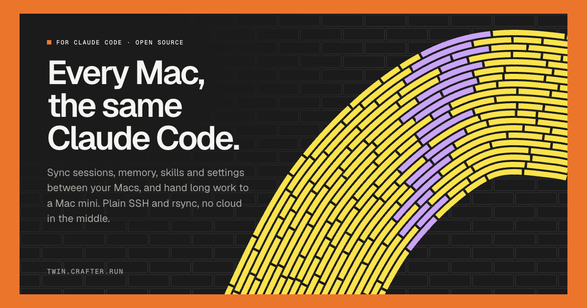
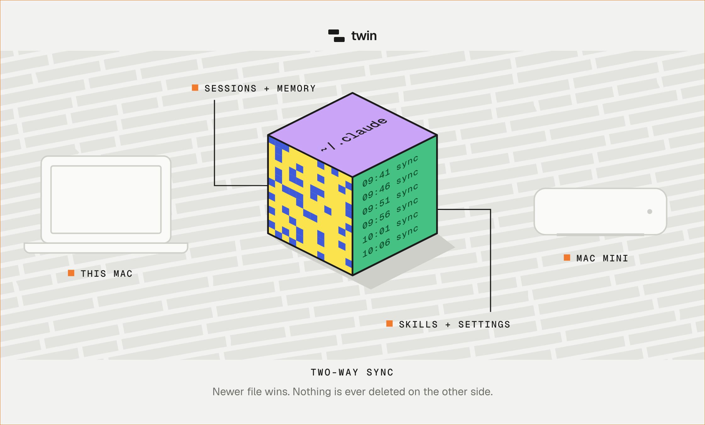

<p align="center">
  <a href="https://twin.crafter.run"></a>
</p>

<h1 align="center">twin</h1>

<p align="center">Every Mac, the same Claude Code.</p>

<p align="center">
  <a href="https://www.npmjs.com/package/@crafter/twin"></a>
  <a href="LICENSE"></a>
  <a href="https://twin.crafter.run"></a>
</p>

`twin` keeps your Claude Code identical across Macs (sessions, memory, skills, settings, prompt history, MCP servers) and turns a Mac mini into a machine you hand work to. It talks plain SSH and rsync, prefers the USB-C cable when it is plugged in, and every command speaks JSON for agents.

```bash
npm i -g @crafter/twin
twin pair       # finds the other Mac, trusts it once
twin setup      # makes it match this Mac, turns on auto sync and Remote Control
```

## Why

Claude Code keeps everything on the machine it runs on. Anthropic's docs say it plainly: auto memory is machine-local, transcripts are filed by folder path, and by default they are deleted after 30 days. There is no built-in sync. `twin` fills that gap without a cloud in the middle.

## Every day

```bash
twin sync                         # two-way, newer file wins, backups kept 14 days
twin status                       # both Macs, route, pending changes, jobs
twin run "run the e2e suite and fix what fails"
twin jobs                         # what is running on the mini
twin logs -f                      # watch the last job live
twin fetch                        # bring its changes and its session back
claude --resume <session>         # keep going on the laptop
twin claude                       # open Claude Code on the mini, in this same folder
twin send                         # copy this project to the same path on the mini
twin fetch --here                 # bring this project's changes back
```

`twin run` copies the project (never `node_modules` or build output) and its memory to the same path on the mini, then starts headless Claude Code there under `caffeinate`. Close the lid; it keeps working.

## What syncs

<p align="center">
  
</p>

| Scope | What | How |
|---|---|---|
| `config` | `settings.json`, `CLAUDE.md`, skills, commands, agents, hooks, output styles, `~/.agents/skills` | rsync, newer wins |
| `sessions` | transcripts, auto memory, checkpoints, todos, plans | rsync, newer wins |
| `history` | prompt history for ↑ and ctrl+r | line merge, sorted by time |
| `mcp` | `mcpServers` in `~/.claude.json` | key merge, nothing else in the file is touched |
| `projects` | folders you link with `twin link`, every file including `.env` and `.git` | three-way against the last sync: edits, deletes and conflicts |

Never synced: credentials (each Mac signs in on its own), plugin caches, `settings.local.json`, shell snapshots and other runtime state.

### Linked folders

```bash
twin link            # keep this folder 1:1 on both Macs
twin link --all      # also node_modules and build output
twin unlink          # stop; the files stay on both Macs
twin projects        # what is linked
```

A linked folder rides every `twin sync` and auto sync. twin remembers what both Macs had after the last sync, so it can tell an edit from a delete: a file removed on one Mac is moved to `~/.twin/backups` on the other, and a file changed on both keeps the newer copy and backs up the other. If both Macs commit to the same branch, the newer tip wins and the other is saved under `refs/twin/kept/`, so no commit is lost. Give agents on different Macs their own branches and they never collide.

Use `--only sessions,history`, `--dry-run`, or `push`/`pull` with `--force` to make one side win.

## The Mac mini

```bash
twin rc on        # always-on Remote Control, restarts after crashes and reboots
twin login        # sign in to Claude Code on the mini
twin doctor --fix # checks paths, versions, sign-in, sleep, retention, and fixes what it can
twin auto on      # background sync every 5 minutes while the mini is reachable
twin install      # put twin itself on the mini as one standalone binary, no Node needed
```

Routes are picked per command: USB-C or Thunderbolt link first, then LAN, then Tailscale, then Bonjour names. `twin status` shows which one it used.

## For agents

Add `--json` to any command. Success is `{"ok": true, ...}`, failure is `{"ok": false, "error": {"code", "message", "hint"}}`, and exit code 2 means the other Mac is away. `twin skill` installs a Claude Code skill so every session knows when to delegate.

## Different usernames

The Macs do not need the same account. When the home folders differ (`/Users/cris` and `/Users/cris-mini`), twin translates on every copy: session folder names, and full paths inside text files such as transcripts, memory, history, settings and MCP configs. It matches whole usernames only, leaves binary files and file checkpoints byte for byte, and keeps timestamps so newer-wins stays exact.

## Rules that keep it safe

- Never deletes on the other side. Files that get replaced are backed up to `~/.twin/backups`. In a linked folder, a file you delete on one Mac is moved to the backups on the other, not erased.
- Do not open the same session on both Macs at once. Separate sessions are fine.

## Site

The landing page at [twin.crafter.run](https://twin.crafter.run) is one static file, `site/index.html`, with every illustration drawn in code.

## License

MIT

<p align="center">Made with 💛 from Latam by <a href="https://crafter.run">Crafter Station</a> · Built by <a href="https://cris.fast">Cristian Correa</a></p>
